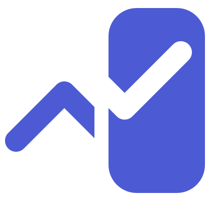
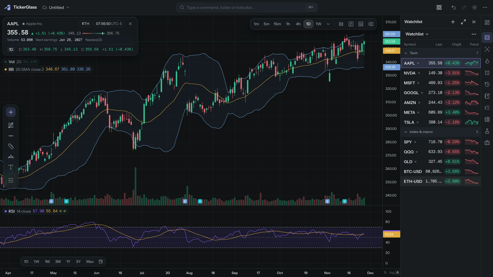
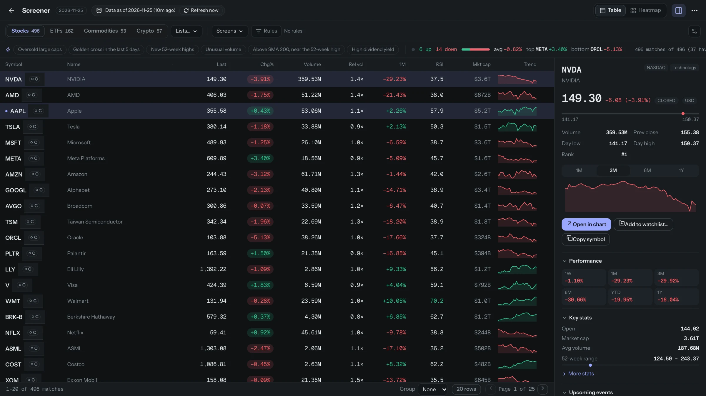
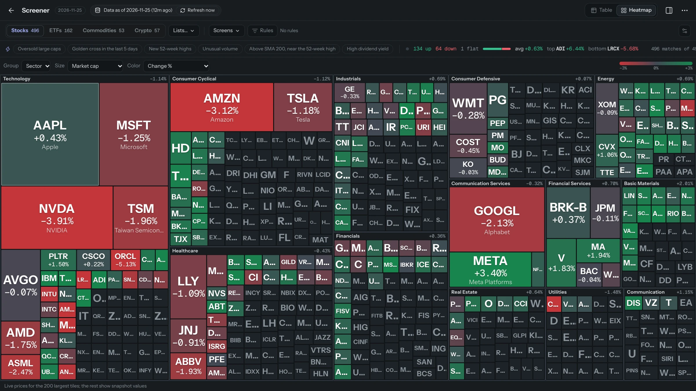
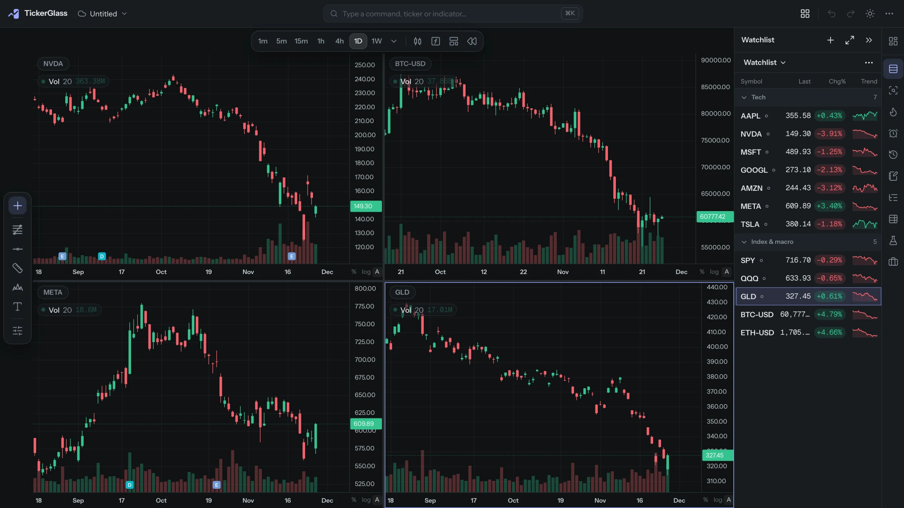
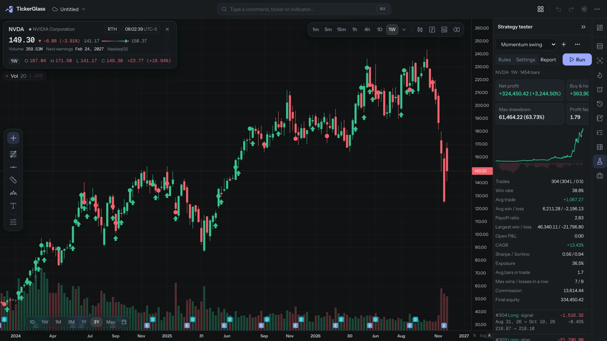
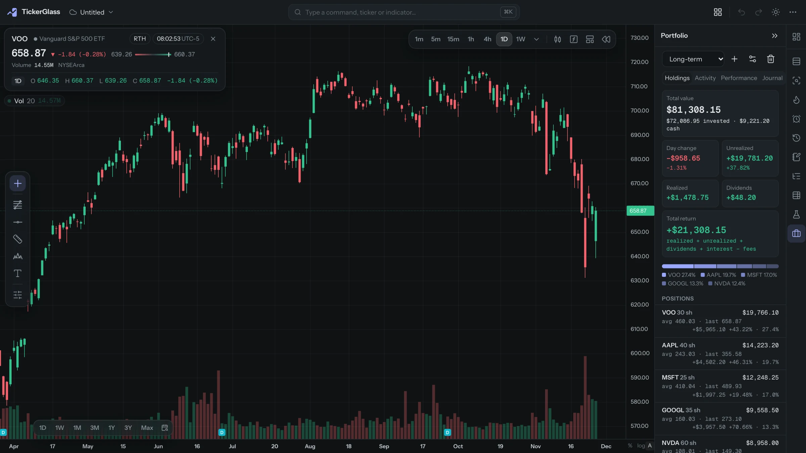
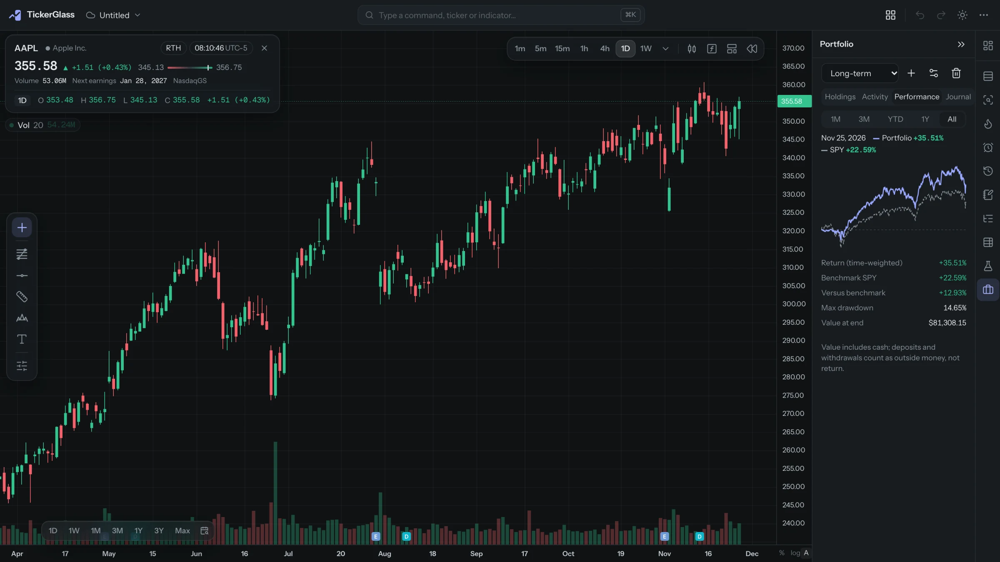
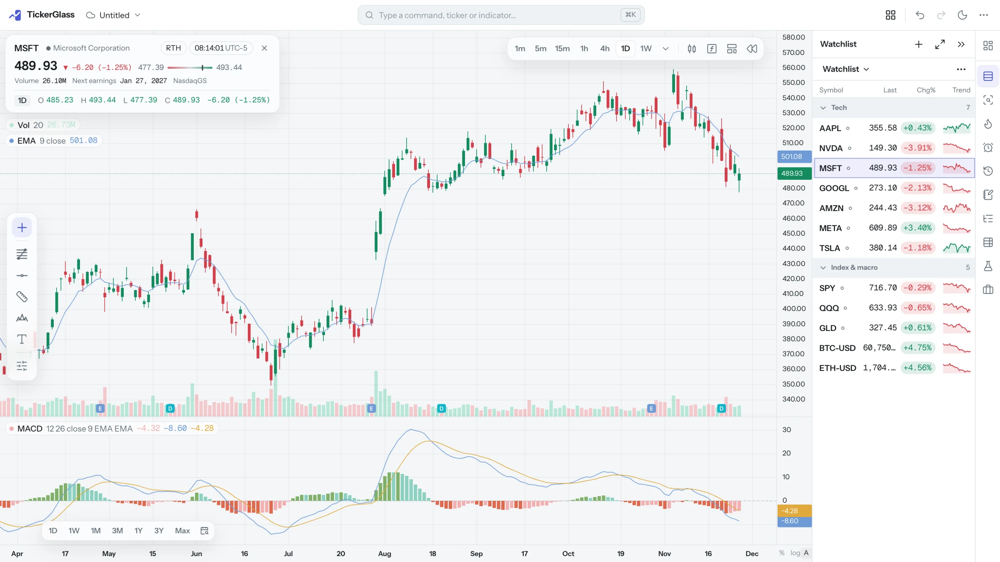
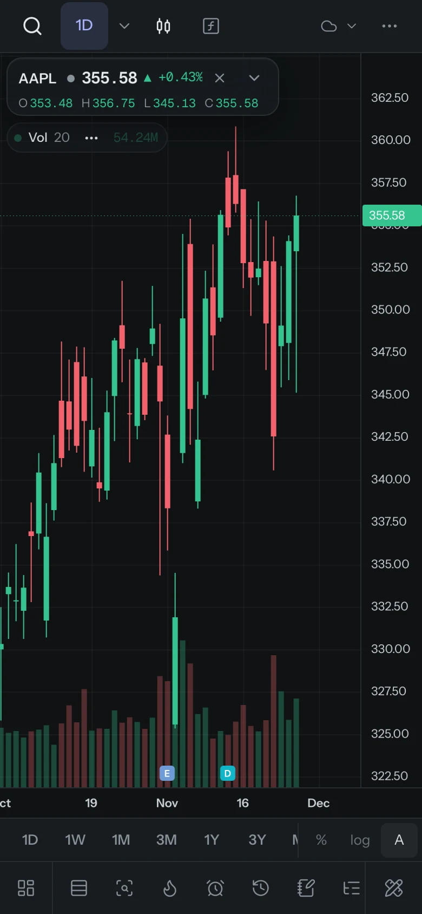

<div align="center">



# TickerGlass

**Pro-grade stock charting, screening and portfolio tracking that runs on your own machine.**

No subscription, no ads, no telemetry. Your watchlists, drawings, alerts and trades stay in your own database.

[](LICENSE)
[](#quick-start)
[](docs/self-hosting.md)
[](#install-as-an-app)

[Quick start](#quick-start) · [Features](#features) · [Screenshots](#a-closer-look) · [Self-hosting guide](docs/self-hosting.md) · [Docs](#documentation)

<br>



</div>

---

## Why TickerGlass?

Serious charting tools usually put the useful parts behind a monthly plan: more than one chart per
layout, alerts that keep running after you close the tab, screeners, backtesting, intraday replay.
They also keep your watchlists, drawings and trading history on their servers.

TickerGlass gives you those features as free, open-source software that you run yourself.

- 🔒 **Your data stays with you.** Everything you create lives in a SQLite (or PostgreSQL) database
  on your own computer, NAS or server. No account with us, no telemetry, no analytics.
- 💸 **No paid tiers.** Every feature is in the box. There are no limits on layouts, charts,
  indicators or alerts beyond what your hardware can handle.
- 🔌 **Bring your own data.** Yahoo Finance works without an API key. You can also switch to
  Twelve Data, Alpaca, Tiingo, Massive (Polygon.io), Stooq or public crypto exchange data, or to a
  fully offline demo feed.
- 🐳 **One command to run.** Docker Compose on Linux, macOS or Windows, with ready-made templates for
  Unraid, TrueNAS, CasaOS, Umbrel and Kubernetes (Helm).

### Features that are usually paid add-ons

| Capability                                                         | Typical hosted charting platform | TickerGlass |
| ------------------------------------------------------------------ | :------------------------------: | :---------: |
| Several charts per layout (up to 16, synced)                       |            Paid tiers            |     ✅      |
| Server-side alerts that fire with the browser closed               |       Limited count / paid       |     ✅      |
| Alert delivery to Telegram, email, ntfy, Gotify, Apprise, webhooks |           Some or none           |     ✅      |
| Market screener with heatmap, saved screens and screen alerts      |            Often paid            |     ✅      |
| No-code strategy tester with a full performance report             |            Often paid            |     ✅      |
| Intraday bar-by-bar market replay with paper trading               |            Often paid            |     ✅      |
| Portfolio tracker with broker CSV import and a trade journal       |     Separate product / paid      |     ✅      |
| Custom indicators in JavaScript                                    |   Proprietary script language    |     ✅      |
| Unlimited indicators per chart                                     |       Capped on free plans       |     ✅      |
| Data stored on hardware you control, full backup download          |                ❌                |     ✅      |
| No ads, no tracking                                                |          Varies by plan          |     ✅      |

<sub>The comparison describes common patterns in hosted charting services in general, not any specific product.</sub>

## Features

<table>
<tr>
<td width="50%" valign="top">

**📈 Charting**

- Candles, hollow candles, bars, line, area, baseline, columns, Heikin Ashi, Renko, Kagi, Line Break, Point & Figure and more
- 85+ built-in indicators: moving averages, Bollinger, Ichimoku, Supertrend, VWAP and anchored VWAP, volume profile, chart-pattern detection
- 70+ drawing tools: trend lines, 10 Fibonacci tools, Gann boxes, fans and squares, chart patterns, measuring and text tools
- [Compare symbols and chart formulas](docs/compare.md) like `AAPL/MSFT` or `(A+B)/2`
- Earnings, dividend and split markers on the chart
- [Multi-chart layouts](docs/multi-chart.md) with up to 16 charts, and synced symbol, interval, crosshair and time
- [Market replay](docs/replay.md), bar by bar or tick by tick, with paper trading
- [Your own indicators in JavaScript](docs/user-scripts.md), run in a sandbox
- Templates, saved layouts, a command palette (<kbd>⌘K</kbd>) and keyboard shortcuts

</td>
<td width="50%" valign="top">

**🔎 Research and trading tools**

- [Screener](docs/screener.md) for stocks, ETFs, commodities and crypto, with a rule builder, saved screens, hotlists and a sector heatmap
- [Watchlists](docs/watchlists.md) with sections, sparklines, flags and plain-text import and export
- [Alerts](docs/alerts.md) on price, indicators, drawings or scripts, evaluated on the server around the clock
- [Strategy tester](docs/backtest.md) for entry and exit rules, with stops and targets, commission, slippage and an equity curve
- [Portfolio tracker](docs/portfolio.md) with holdings, time-weighted performance against a benchmark, dividends and a trade journal
- Broker CSV import for IBKR, Schwab, DEGIRO, Trading 212 and generic files

**🏠 Self-hosting**

- Prebuilt multi-arch images (amd64 and arm64) that also run on a Raspberry Pi or NAS
- Optional password, [single sign-on (OIDC)](docs/self-hosting.md#single-sign-on-oidc) or [auth proxy](docs/self-hosting.md#behind-an-auth-proxy) sign-in
- [Multiple users](docs/self-hosting.md#users), each with their own data
- Backups from the UI, SQLite or PostgreSQL, and [Prometheus metrics](docs/metrics.md)
- Installable PWA for desktop and mobile

</td>
</tr>
</table>

## A closer look

<table>
<tr>
<td width="50%"><br><sub><b>Screener</b>: rank roughly 800 stocks, ETFs, commodities and crypto from a nightly snapshot, with fundamentals, performance and RSI columns.</sub></td>
<td width="50%"><br><sub><b>Heatmap</b>: size tiles by market cap, color them by change, group them by sector, and click a tile to open its chart.</sub></td>
</tr>
<tr>
<td width="50%"><br><sub><b>Multi-chart layouts</b>: up to 16 charts in one layout, with synced interval, crosshair and time.</sub></td>
<td width="50%"><br><sub><b>Strategy tester</b>: build rules without code and get net profit, drawdown, Sharpe and Sortino ratios, and a list of trades.</sub></td>
</tr>
<tr>
<td width="50%"><br><sub><b>Portfolio</b>: track holdings, cash, and realized and unrealized P&amp;L, and import trades from your broker's CSV.</sub></td>
<td width="50%"><br><sub><b>Performance</b>: time-weighted return compared with a benchmark of your choice.</sub></td>
</tr>
<tr>
<td width="50%"><br><sub><b>Light and dark themes</b>, both designed for long sessions.</sub></td>
<td width="50%" align="center"><br><sub><b>Installable PWA</b> for phones, tablets and desktops.</sub></td>
</tr>
</table>

## Quick start

Requirements: Docker Engine and the Docker Compose plugin.

### Prebuilt images (recommended)

You don't need to clone or build anything. Multi-arch images (amd64 and arm64) are published with every release:

```sh
mkdir tickerglass && cd tickerglass
curl -O https://raw.githubusercontent.com/YavuzAkbay/TickerGlass/main/docker-compose.yml
curl -O https://raw.githubusercontent.com/YavuzAkbay/TickerGlass/main/.env.example
mv .env.example .env
docker compose pull
docker compose up -d
```

Open <http://localhost:8080>. That's it.

To update later, run `docker compose pull && docker compose up -d`. To pin a version, set `TICKERGLASS_TAG` in `.env`. See the [self-hosting guide](docs/self-hosting.md) for details.

### Build from source

```sh
git clone https://github.com/YavuzAkbay/TickerGlass.git
cd TickerGlass
cp .env.example .env
docker compose up -d --build
```

The web UI is at <http://localhost:8080>, and the API health endpoint is at <http://localhost:8000/api/health>.

### App stores and NAS platforms

Templates for **Unraid, TrueNAS, CasaOS, Umbrel** and a **Helm chart** for Kubernetes are in [`deploy/`](deploy). A single-container all-in-one image (`ghcr.io/yavuzakbay/tickerglass`, port 8080) backs the Unraid and CasaOS templates. See [Option C in the self-hosting guide](docs/self-hosting.md#option-c-app-stores).

### Remote access and security

The web and API ports bind to localhost by default. To use TickerGlass from another device:

1. Set up sign-in first: `AUTH_PASSWORD` in `.env`, [single sign-on](docs/self-hosting.md#single-sign-on-oidc) or an [auth proxy](docs/self-hosting.md#behind-an-auth-proxy). See [password protection](docs/self-hosting.md#password-protection).
2. Then expose it through a reverse proxy or Tailscale, with HTTPS.

Don't expose the API port publicly.

### Data and backups

SQLite data is stored in the persistent `api-data` Docker volume. Back that volume up regularly, or use **Settings → Server → Download backup**. To use PostgreSQL, follow the commented configuration in `.env.example` and start the optional database profile:

```sh
docker compose --profile postgres up -d --build
```

`docker compose down` stops the services and keeps your data. `docker compose down -v` also **deletes** the database volume.

## Install as an app

The web app is a PWA. In Chrome or Edge on the desktop, and in Android browsers, use the install icon in the address bar ("Install TickerGlass" or "Add to home screen"). On iOS, use Share → Add to Home Screen. The installed app opens without the browser UI, and the charts you have open keep working while the server is briefly unreachable.

## Market data and offline use

TickerGlass recommends Yahoo Finance through `yfinance` as its default provider. The API requests data from the provider for your instance; TickerGlass does not package, own, or redistribute Yahoo Finance market data. You can implement or configure another provider; see [provider configuration](docs/providers.md). Each provider has its own availability, terms, and data rights, which are outside this project's control. Review the applicable terms and laws for your location and use case before accessing, displaying, storing, or sharing provider data.

| Provider    | `MARKET_PROVIDER` | Key needed                              | Notes                                                       |
| ----------- | ----------------- | --------------------------------------- | ----------------------------------------------------------- |
| Yahoo       | `yahoo` (default) | no                                      | via `yfinance`                                              |
| Twelve Data | `twelvedata`      | `TWELVEDATA_API_KEY`, `TWELVEDATA_PLAN` | requests are paced to your plan's credits                   |
| Alpaca      | `alpaca`          | `ALPACA_KEY_ID`, `ALPACA_SECRET_KEY`    | US stocks and crypto, free IEX feed, live trades            |
| Tiingo      | `tiingo`          | `TIINGO_API_KEY`                        |                                                             |
| Massive     | `massive`         | `MASSIVE_API_KEY`                       | formerly Polygon.io                                         |
| Stooq       | `stooq`           | `STOOQ_API_KEY`                         | unofficial daily data; key comes from a captcha page        |
| Crypto      | `crypto`          | no                                      | Kraken, Coinbase or Binance public data (`CRYPTO_EXCHANGE`) |
| Demo        | `demo`            | no                                      | generated prices, **no network requests at all**            |

Switching provider clears the cached market data but not your own data. Plan limits and caveats for each provider are in [provider configuration](docs/providers.md).

For a fully offline setup, set this in `.env` and restart:

```dotenv
MARKET_PROVIDER=demo
```

Demo prices are synthetic and are not real quotes.

## Alert notifications

Alerts are evaluated by the `alerts` service and keep running while the browser is closed. In-app, sound and browser notifications need no external service. Telegram, email, ntfy, Gotify, Apprise and webhooks are optional and need credentials or endpoints that you put in `.env`. Keep that file private and don't commit secrets. Setup details are in [the alerts guide](docs/alerts.md#4-notification-delivery).

## Configuration

Copy `.env.example` to `.env`. Common settings:

| Variable          | Purpose                                                                                                                                                                                                                          |
| ----------------- | -------------------------------------------------------------------------------------------------------------------------------------------------------------------------------------------------------------------------------- |
| `WEB_PORT`        | Local web UI port (default `8080`)                                                                                                                                                                                               |
| `API_PORT`        | Local API port (default `8000`)                                                                                                                                                                                                  |
| `MARKET_PROVIDER` | `yahoo` (default), `twelvedata`, `alpaca`, `tiingo`, `massive`, `stooq` (each needs its key), `crypto` (no key) or generated `demo` data                                                                                         |
| `DATABASE_URL`    | Optional database connection; SQLite is the default                                                                                                                                                                              |
| `TICKERGLASS_TAG` | Published image tag to run (`latest` default, or `vX.Y.Z`); used by `docker compose pull`                                                                                                                                        |
| `AUTH_PASSWORD`   | Optional sign-in password; unset keeps the app open (localhost-first). OIDC and proxy-header sign-in: see `.env.example`. Several people can share one server, each with their own data: see [users](docs/self-hosting.md#users) |
| `METRICS_ENABLED` | `true` serves Prometheus metrics at `/metrics` (default off); see [metrics](docs/metrics.md)                                                                                                                                     |
| `METRICS_TOKEN`   | Bearer token (16+ characters) Prometheus must send; required with sign-in unless `METRICS_PUBLIC=true`                                                                                                                           |
| `METRICS_PUBLIC`  | `true` allows `/metrics` without a token (only if the port is not exposed to untrusted networks)                                                                                                                                 |

The example file documents the database, auth and alert settings. Don't share `.env`, because it may contain passwords, tokens and webhook secrets.

## Documentation

| Topic                                      | Topic                                      |
| ------------------------------------------ | ------------------------------------------ |
| [Self-hosting](docs/self-hosting.md)       | [Market data providers](docs/providers.md) |
| [Indicators](docs/indicators.md)           | [User scripts](docs/user-scripts.md)       |
| [Drawings](docs/drawings.md)               | [Compare and symbol math](docs/compare.md) |
| [Multi-chart layouts](docs/multi-chart.md) | [Market replay](docs/replay.md)            |
| [Alerts](docs/alerts.md)                   | [Screener](docs/screener.md)               |
| [Watchlists](docs/watchlists.md)           | [Strategy tester](docs/backtest.md)        |
| [Portfolio](docs/portfolio.md)             | [Caching](docs/caching.md)                 |
| [Metrics](docs/metrics.md)                 | [Known limitations](docs/LIMITATIONS.md)   |

## Development

Requirements: Node.js 24+, [pnpm](https://pnpm.io/) and [uv](https://docs.astral.sh/uv/).

```sh
pnpm install
cd api && uv sync && cd ..
```

Run the API in one terminal and the web app in another:

```sh
cd api && uv run uvicorn tickerglass_api.app:app --reload
```

```sh
pnpm dev
```

The web development server runs on port 5173 and proxies API and WebSocket requests to port 8000.

### Project layout

| Path                  | Contents                                               |
| --------------------- | ------------------------------------------------------ |
| `apps/web`            | React application and chart interface                  |
| `packages/engine`     | Framework-independent Canvas 2D chart engine           |
| `packages/indicators` | Indicators shared by the web app and the alert service |
| `packages/backtest`   | Strategy tester rules, simulation and statistics       |
| `services/alerts`     | Server-side alert evaluation                           |
| `api`                 | FastAPI market data API, caching and storage           |
| `deploy`              | Unraid, TrueNAS, CasaOS, Umbrel and Helm templates     |

## Contributing

Contributions are welcome. Read [CONTRIBUTING.md](CONTRIBUTING.md) and the [Code of Conduct](CODE_OF_CONDUCT.md) first. For anything bigger than a small fix, please open an issue before starting. [Known limitations](docs/LIMITATIONS.md) is a good place to find open work.

If TickerGlass is useful to you, a ⭐ on GitHub helps other people find it.

## Privacy

Self-hosting lets you control where the application server and database run. TickerGlass includes no analytics or telemetry. Browser preferences and some chart data are also kept in that browser's local storage. With the default Yahoo provider, your server contacts Yahoo Finance for market data. If you configure notification integrations, alert messages are sent to the services you select. Review the code and configuration for your deployment before making privacy claims about a particular setup.

## Disclaimer

TickerGlass is provided for informational and educational purposes. It is not investment, financial, tax, or legal advice, and it does not recommend buying or selling any security. Market data may be delayed, incomplete, inaccurate, or unavailable. You are responsible for your decisions and for checking data before relying on it.

TickerGlass is independent and is not affiliated with or endorsed by Yahoo or any other data provider. Product names and trademarks belong to their respective owners. This project does not grant rights to third-party data or trademarks. Check each provider's terms before accessing, storing, displaying, or sharing its data.

## License

TickerGlass is licensed under the [GNU Affero General Public License, version 3](LICENSE). You may use, modify, and share the software under that license. If you modify it and let people interact with your modified version over a network, AGPL-3.0 requires you to offer those users the corresponding source code under the license terms. See the license text for the complete terms.

Third-party dependencies and data providers may have separate terms. This README is project information, not legal advice. No README wording can guarantee that a project or its users will never face a legal claim; review dependency, data-provider, and trademark obligations for your intended use.
